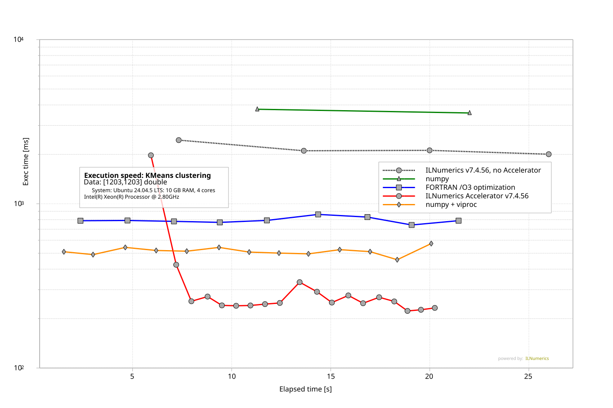

# Artifact 3 - K-Means Clustering

Demonstrates ILNumerics strong scaling capabilities when calculating the *iterative* k-means clustering algorithm

on moderately sized data. (`A: [1203,1203]`),  
when executed by: 
* NumPy, 
* FORTRAN /O3 (all optimizations), with 
* [ILNumerics Accelerator](https://ilnumerics.net/ilnumerics-accelerator-compiler.html).
* NumPy + [viproc](https://github.com/hokb/viproc): the same, unchanged NumPy script, run by `python -m viproc` (added later, see [viproc](#viproc) below).

This benchmark uses the iterative k-means clustering algorithm for demonstrating the ability of ILNumerics Accelerator to speed-up even such algorithms, which spend most of their calculation time inside *order dependent loops*. Where traditional parallelization fails ILNumerics Accelerator is able to turn fine grained parallel potential into speed-up, gained on multiple computing devices. Here, Array Instruction Level Parallelizm (AILP) accelerates the iterative algorithm beyond FORTRAN speed by a **factor of 3x**. The benchmark produces a plot, similar to the following: 
  
Each technology (NumPy, FORTRAN, ILNumerics) was provided with identical input data of size [1203x1203] and start configuration to ensure identical iteration count. Results were identity checked.
Each sample in the plot gives the time needed for computing the k-means clusters until convergence (here: 5 iterations). This 'current execution speed' is plotted for 20 seconds, after a warm-up of 2 seconds, and repeated for all execution technologies investigated (the paper's figure shows the first 15 seconds, without warm-up). 

Observed execution times for all experiments over the app's running time allow to compare not only the general efficiency of the individual optimization methods. It also allow to inspect the behavior of the method during start-up and in a steady run.

## Benchmark Structure
All benchmarks are handled from `ILNumerics\Part3.csproj`. At runtime it starts the NumPy script, starts the FORTRAN executable, and starts the ILNumerics .NET benchmarks. 
Each experiment first runs for 2 sec of warm-up (not recorded), then it is measured and repeated for 20 sec. Times needed for each completed iteration are written to csv files. 
Afterwards, the plot corresponding to Figure 7 in the paper is generated using measured results. The paper publishes plots produced on Windows. Here, we present plots created on a Debian based Docker container - differences are discussed below. 

## Clone the repository (all benchmarks)

```
git clone https://github.com/hokb/decentralized-array-execution-artifacts2026 
```
Navigate into directory: `Appendix/Part 3 KMeans`.

## Running the Benchmark using Docker ... (recommended)

This will: 
* build a debian based docker image, 
* install the .NET 8.0 SDK, 
* copy FORTRAN, NumPy and ILNumerics benchmark sources, 
* compile FORTRAN binaries (optimized, using gfortran)
* compile the ILNumerics assembly using ILNumerics Accelerator
* run the ILNumerics assembly, starting all other measurements
* create the final plots. 

### ... on Windows
```PowerShell
ps> .\run-docker.ps1
```

### ... on Linux

```bash
> .\run-docker.sh
```

## Running the Benchmark from Code
Make sure to have the latest .NET SDK and prerequisites to compile the FORTRAN sources installed. Find instructions in [here](/System%20Setup.txt).

Navigate into the `ILNumerics` subdirectory and start the project `Part3.csproj`:

```bash
dotnet run Part3.csproj -c Release
```

## Results
The benchmark generates the following results and places them into a new folder: `\Appendix\Part 3 KMeans\result`.
* classes.csv - cluster assignments (from last experiment)
* input.csv   - common input data (for all experiments)
* values.csv  - measurment values (times, ms; for all experiments). Source for plot generation. Measurement IDs: 0 ILNumerics, no Accelerator; 1 ILNumerics Accelerator; 2 NumPy; 3 FORTRAN; 4 numpy + viproc. 
* Plots generated: Part3.bmp and Part3.svg

* ## Repeating the experiment / Re-Run
Re-Running the project will only re-create the plot. To trigger a new *measurement* just delete the `result` folder `Appendix\Part 3 KMeans\result\`.  

## viproc

[viproc](https://github.com/hokb/viproc) adds array instruction level parallelism to regular NumPy programs: it runs the unchanged NumPy script (`numpy/Part3_noopt/Part3_noopt.py`) with `python -m viproc`, issues its array instructions asynchronously and executes them in parallel where their data dependencies allow it, using NumPy's own kernels. viproc is another implementation of the array instruction level parallelism (AILP) published in the paper: the same decentralized execution model as the ILNumerics Accelerator, built for Python and NumPy instead of .NET, but without micro kernels and staged pipelining. Its results are bit-identical to NumPy; the benchmark checks the cluster assignments and the iteration count as for the other technologies.

`Part3.cs` measures it as measurement ID 4 (orange line, "numpy + viproc"), with the same Python and NumPy as the NumPy measurement. The Docker image installs viproc when it is built. When running from code, `Part3.cs` installs it from GitHub before the first measurement if the Python cannot import it: into that Python with pip, or, where that is not possible (an externally managed system Python, no write access), into a virtual environment `.viproc-venv` next to `result`, whose Python then runs both the NumPy and the viproc measurement. viproc is built from source and needs Python >= 3.12 with its headers (Debian/Ubuntu: `python3-dev`, `python3-venv`), a C/C++ compiler and internet access; NumPy >= 2.5 is installed with it. If the installation fails, the program stops with a message before measuring. Environment variables: `PART3_PYTHON` selects the Python executable, `VIPROC_PIP_SPEC` what pip installs (default: the `main` branch of https://github.com/hokb/viproc).

Measurement with viproc, `result_archive_viproc/` (Ubuntu 24.04 VM, Intel Xeon @ 2.80 GHz, 4 cores, 10 GB RAM; Python 3.12, NumPy 2.5.4, viproc installed by `Part3.cs` into `.viproc-venv`; run from code, not in Docker; 2 s warm-up, 20 s measurement per technology), median time per k-means run (5 iterations), each sample averaged over 3 runs:

| technology | median [ms] | min [ms] |
|---|---:|---:|
| NumPy | 3668 | 3573 |
| ILNumerics, no Accelerator | 2110 | 2004 |
| FORTRAN /O3 | 789 | 743 |
| numpy + viproc | 511 | 457 |
| ILNumerics Accelerator | 250 | 223 |



Notes on this run:
* The NumPy time on this VM is dominated by page faults: each temporary of `X[:,i,newaxis] - centers` (481 KB) is `mmap`ed and unmapped by glibc's allocator, and page faults are expensive in this virtual machine (with `MALLOC_MMAP_THRESHOLD_=100000000` one distance step takes 220 instead of 610 µs). viproc reuses element memory from its own pool and avoids them. Compare viproc rather with FORTRAN and ILNumerics here, or rerun on hardware with cheaper page faults (the Windows i7-12700K measurement in `result_archive/`: NumPy 599 ms).
* ILNumerics ran under its 'Starter' plan conditions (no license embedded in this build).
* 4 cores only; the Accelerator results in `result_archive/` were measured on 12 cores.
* The VM varies between runs: an earlier run on the same VM gave medians of NumPy 4720, ILNumerics no Accelerator 2529, FORTRAN 769, numpy + viproc 545 and ILNumerics Accelerator 471 ms.
* The ILNumerics Accelerator needs longer than the 2 s warm-up to reach its steady speed here (its first samples, until ~7 s, are slower); the medians above include them.

## Discussion
ILNumerics Accelerator uses parallel potential on array instruction level and on sub-array instruction level (AILP). It enables to run multiple array instructions concurrently using multiple devices (as: individual cores of the CPU) and also to compress array instruction execution start times in the time domain by starting subsequent instructions as soon as the required *sub-part* of its input data is available. For example: the size of an input A is enough to start computing the size of the output of the function: `sin(A)`. 

This benchmark demonstrates that a reliable speed-up can be gained by using AILP. It quantifies this speed-up and shows a ~3 times speed-up compared to the FORTRAN (non-parallelized) baseline. Note, that it would be far from  trivial to parallelize the FORTRAN version efficiently - while ILNumerics Accelerator does not require any manual marks or decisions by the programmer. 

The benchmark also shows a significant warm-up overhead for the ILNumerics Accelerator. The authors believe that this issue can be addressed by more efficient caching of low-level kernels, by optimizing / pre-loading of compiler infrastructure at program start. Also, we believe that a further, significant speed-up can be gained by using kernel optimizations which are still in experimental stage currently (see: [Part1](..\Part1%20Low%20Level%20Expressions\Readme.md) and by automatically involving other computing device categories, as: GPUs.

## Feedback
Please let us know about your findings! Did you observe similar results ? Get in touch and have us take a look: [benchmarks@ilnumerics.net](benchmarks@ilnumerics.net)
