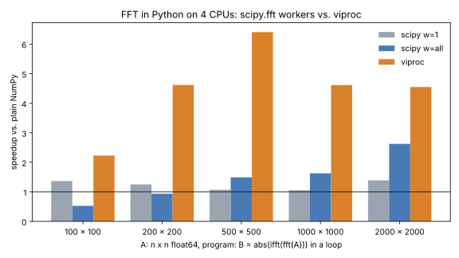

# Artifact 4 - Faster FFT in Python: NumPy, scipy.fft and viproc

The [Faster Fast Fourier Transform](https://ilnumerics.net/Faster-Fast-Fourier-Transform.html) experiment of ILNumerics, ported to Python. It runs the program

```python
for _ in range(reps):
    B = np.abs(np.fft.ifft(np.fft.fft(A)))     # A: n x n float64, one FFT per row
```

with `A = arange(0, n) * flip(arange(0, n)).T` (the input of the article) in four ways:

| method | what runs in parallel |
|---|---|
| **numpy** | nothing: NumPy's FFT (pocketfft) is single-threaded |
| **scipy w=1** | nothing: `scipy.fft` with one worker |
| **scipy w=all** | the rows *inside* each FFT call: `scipy.fft.fft(A, workers=-1)` |
| **viproc** | whole FFT calls: the unchanged NumPy program on [viproc](https://github.com/hokb/viproc) arrays |

[viproc](https://github.com/hokb/viproc) adds array instruction level parallelism (AILP) to regular NumPy programs, following the execution model of [ILNumerics Accelerator](https://ilnumerics.net/ilnumerics-accelerator-compiler.html): the Python thread only issues array instructions and races ahead; every instruction runs as a task on a worker thread as soon as its inputs are ready. Each `fft`/`ifft`/`abs` call is one task that calls NumPy's own kernel (single-threaded, as in NumPy), so its result is bit-identical to NumPy's. The speed-up comes from the iterations of the loop overlapping: none of them depends on another one.

`scipy.fft` instead splits the rows of a single call over its workers. That pays off only for large arrays, and its pocketfft version gives results that differ from NumPy's in the last bits.

## Results

4 CPUs (Intel Xeon @ 2.80 GHz, Linux VM), CPython 3.13, NumPy 2.5.4, SciPy 1.18.1, viproc 0.1.0 (commit [75715d2](https://github.com/hokb/viproc/commit/75715d2747f8d5f05e5a2a475ae2ed2cc79b22b9), asynchronous `numpy.fft` since [PR #36](https://github.com/hokb/viproc/pull/36)). Time per expression `abs(ifft(fft(A)))`, the best of 5 runs of 100 iterations (20 for n = 2000):



| n x n | numpy | scipy w=1 | scipy w=all | viproc | viproc vs. scipy w=all |
|---:|---:|---:|---:|---:|---:|
| 100 | 0.144 ms | 0.105 ms (1.4x) | 0.274 ms (0.5x) | 0.065 ms (**2.2x**) | 4.2x |
| 200 | 0.88 ms | 0.70 ms (1.3x) | 0.94 ms (0.9x) | 0.19 ms (**4.6x**) | 4.9x |
| 500 | 8.6 ms | 8.1 ms (1.1x) | 5.8 ms (1.5x) | 1.35 ms (**6.4x**) | 4.3x |
| 1000 | 27.0 ms | 25.5 ms (1.1x) | 16.6 ms (1.6x) | 5.8 ms (**4.6x**) | 2.8x |
| 2000 | 121 ms | 87 ms (1.4x) | 46 ms (2.6x) | 26.6 ms (**4.5x**) | 1.7x |

Speed-ups in parentheses are against plain NumPy. Bit-identical to NumPy: numpy and viproc yes, scipy no (all sizes). Timings on this VM vary by about ±20 % between runs. The raw data is in [result_archive/values.csv](result_archive/values.csv).

* **viproc** reaches 2.2x already at 100 x 100 and about 4.5x (the number of cores) from 200 x 200 on, with results identical to NumPy and without a change to the program.
* **scipy.fft with all workers** is slower than NumPy for small arrays: splitting a small FFT costs more than it saves. It gains from 500 x 500 on and reaches 2.6x at 2000 x 2000, where each call has enough work for all cores.
* The gap shrinks for large arrays, where one call alone fills the cores. However, a synchronization after each completed FFT remains, which still slows down the main thread. This matches the observation of the ILNumerics article: overlapping whole array instructions (AILP) brings more than parallelizing inside each one, and most for small and medium sizes.

## Running the Benchmark using Docker (recommended)

The image installs NumPy, SciPy, matplotlib and builds viproc from source (`pip install git+https://github.com/hokb/viproc`). The viproc version is the build argument `VIPROC_REF` (default: `main`; `--build-arg VIPROC_REF=75715d2747f8d5f05e5a2a475ae2ed2cc79b22b9` gives the version measured above).

### ... on Windows
```PowerShell
ps> .\run-docker.ps1
```

### ... on Linux
```bash
> ./run-docker.sh
```

The image (`artefact4:latest`) is built on the first run and kept afterwards: subsequent runs start a new container from the existing image. To build the image again (after changes to the sources, the Dockerfile or `VIPROC_REF`), use `.\run-docker.ps1 -Rebuild` or `./run-docker.sh --rebuild`. Remove the image with `docker rmi artefact4:latest`.

## Running the Benchmark from Code

Requires CPython >= 3.12 and a C/C++ compiler (GCC, Clang or MSVC) for viproc:

```bash
pip install "numpy>=2.5" scipy matplotlib "viproc @ git+https://github.com/hokb/viproc"
python fft_benchmark.py                        # sizes 100 200 500 1000 2000
python fft_benchmark.py --sizes 300 3000 --repeat 3
```

## Output Files

The benchmark writes into the folder `result` (created next to the script, or `--out <dir>`):
* values.csv - time per expression (ms), speed-up vs. NumPy and bit-identity with NumPy for every size and method
* Part4.svg, Part4.png - the plot

## Feedback
Please let us know about your findings! Did you observe similar results ? Get in touch and have us take a look: [benchmarks@ilnumerics.net](benchmarks@ilnumerics.net)
